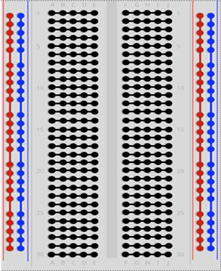
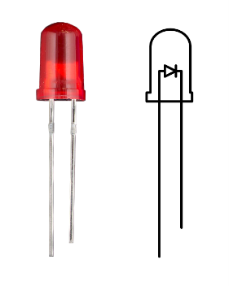
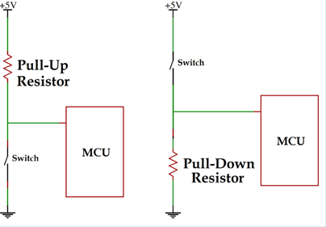
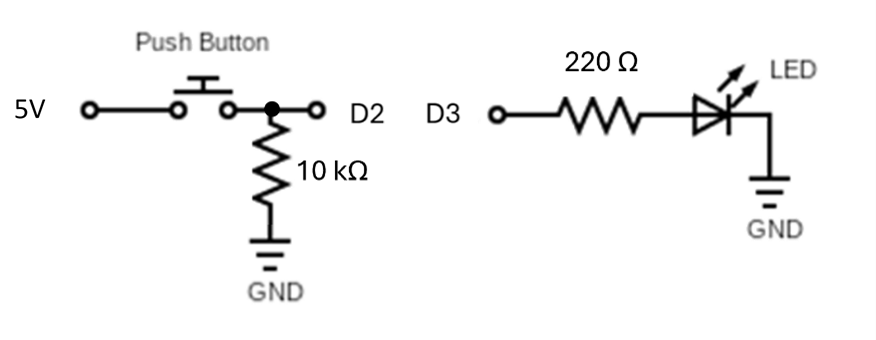
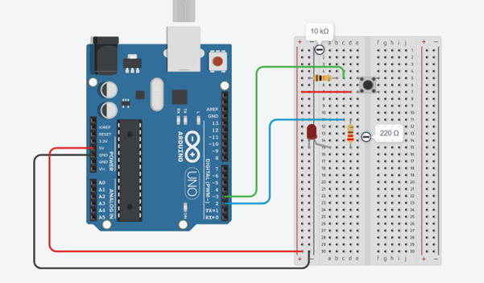

# Breadboarding Basics
## How a Breadboard Works 
A breadboard is a prototyping tool used for building and testing circuits without the need for soldering. It consists of rows and columns of conductive strips underneath a plastic surface with holes, allowing you to easily insert components and wires to form electrical connections. A typical breadboard is divided into two main areas: the power rails and the terminal strips.

The power rails, running along the sides, are used for connecting power (e.g., 3.3V or GND) throughout your circuit. The terminal strips in the center are arranged in rows and connect vertically underneath the board, making it possible to link components without direct wiring. The image below shows a how the connections are made internally on a typical breadboard.

## Wiring Conventions 
When wiring circuits or creating schematics, it’s helpful to follow color conventions to make your work easier to read, debug, and share. A common standard is to use red wires for power (Vcc) and black/blue wires for ground (GND).

Beyond that, it’s up to you to define your own consistent system. A good practice is to use one wire color per signal or per section of a circuit, which keeps things organized — especially as circuits grow more complex.

When you’re just starting out, it’s okay to use a variety of colors to help visualize how different parts of the circuit connect and how signals flow. Over time, developing your own consistent wiring style will make building and troubleshooting much easier.

## Voltage, Current, and Resistance
Voltage is the electrical potential difference between two points in a circuit. It can be thought of as the "push" from an electrical circuit's power source (eg. battery, microcontroller) that pushes charged electrons (current) through the circuit loop. It is measured in volts (V). 

Current is the rate at which electrons flow past a point in an electrical circuit. It is measured in amperes/amps (A). 

Resistance is the obstruction to the flow of current in an electrical circuit. It is measured in ohms (Ω). Resistors are often used to protect circuit components such as LEDs. 

These electrical circuit fundamentals are important to understand and take into consideration when building a circuit in order for them to be safe and effective. A component needs to be powered with the sufficient and safe supply voltage and the component also must give a signal that is safe for the microcontroller to receive. Voltages that are too high can permanently damage the component or microcontroller and voltages that are too low will result in a insufficiently powered circuit. 

## LED Polarity 
Many electronic components, such as resistors, are non-polar. This means that the orientation of the component relative to the flow of electricity does not matter. Other components are polar, where the orientation of the component relative to the flow of electricity does matter. One such component is a diode. Diodes are designed specifically to allow electricity to flow in a certain direction and not in the other. LEDs (light emitting diodes) are diodes that also emit light. The image below shows an LED.

 

Notice that one leg is longer than the other. The longer leg is the anode and is connected to a positive voltage. The shorter leg is the cathode and is connected to a negative voltage (GND). Another method to distinguish polarity is to look at the base of the LED case and where a flat spot can be felt/seen indicates the cathode/negative leg. If the LED is connected in the wrong orientation, then no electricity will flow, and the LED will not light up.

## Pull Up and Down Resistors
If a line in a circuit isn’t explicitly set to a voltage it is considered “floating”. In electronics, it is undesirable for any lines to be floating, so we use pull-up and pull-down resistors to passively set the voltage of lines that are not being set otherwise. The image below shows the wiring diagram for pull-up and pull-down resistors. Please note that MCU stands for microcontroller unit, which in our case is the Arduino Uno.

Consider the pull-down resistor diagram. When the switch is open, the voltage on the MCU pin is very close to ground (if the pull-down resistor has a low resistance, which they typically do). When the switch is closed, the voltage on the MCU pin is 5V, and the resistor measures 5V across. This behaviour is mirrored for the pull-up resistor.

## Building a Circuit 
You will be building a circuit where you will control an LED with a button. When the button is pressed, after a small delay the LED will turn on. You will program the delay in the next section of the workshop and below is circuit that you will build. 

Here’s how the circuit works:
1. The button is connected between the 5V power rail and a digital input pin (e.g., pin 2). When the button is pressed, the pin is connected directly to 5V, and the Arduino will read the pin as “High”.
2. When the button is not pressed, the pin is tied to ground through the 10kΩ pull-down resistor between the input pin and GND. This ensures the input pin not floating when the button is not pressed.
3. The LED is connected in series with a current-limiting resistor to prevent it from burning out. The resistor connects to a digital output pin, which can be toggled HIGH or LOW to turn the LED on or off. Note that the LED must be oriented correctly, with the longer leg (anode) connected to the resistor (and then to the digital output), and the shorter leg (cathode) connected to GND. If you flip the LED, it will not light up.

If you've never used a breadboard before, please refer to Figure 2 and follow these instructions. We are here to help clarify any of these steps. Please ask us if you would like!

1. Place the push button on the breadboard straddling the centre divider. To wire up the push button correctly:
   a) Connect one push button leg to the breadboard's power rail with a red wire.
   b) Using a resistor as a "bridge," connect the other push button leg through the resistor to the ground rail.

The resistor, named a pull-down resistor, is there to limit the amount of current which flows to ground while the push button is activated (this is a consequence of how this circuit was designed). Any current which flows past the resistor while the push button is activated is strictly energy wasted, but it is an acceptable tradeoff because the button will not be activated often and the current is very small. How much power would be dissapated by the resistor while the push button is pressed?

2. Place the LED on the breadboard. To wire up the LED correctly:
   a) Connect the LED’s cathode (shorter leg) to the breadboard’s ground rail (black wire)
   b) Connect the LED’s anode (longer leg) to one end of the 220 Ω resistor (red, red, brown). Put the resistor’s other leg in a different row.

3. Connect the circuit to the Arduino Uno
   a) Connect the pushbutton's unconnected lead to digital pin 3 (this is the green wire in Figure 2).
   b) Connect the 220 Ω resistor's unconnected leg to digital pin 2 (this is the blue wire in Figure 2).
   c) Connect the breadboard’s power rail to the 5V pin on the Arduino with a red wire
   d) Connect the ground rail to the Arduino’s GND pin with a black wire

4. Double check your connections
   - Arduino’s 5V to the power rail
   - Breadboard’s power rail to the pushbutton
   - Pushbutton to 10 kΩ resistor
   - 10 kΩ resistor to digital pin 2
   - Digital pin 3 to the 220 Ω resistor
   - 220 Ω resistor to the LED’s anode (longer leg)
   - LED’s cathode (shorter leg) to the breadboard’s ground rail
   - Ground rail to Arduino’s GND

  <a href="Activity-1-What is a Physical Computing System.md">⬅ Previous</a> | 
  <a href="Activity-2-Breadboarding Basics.md">⬆ Top</a> |
  <a href="Activity-3-Meet the Microcontroller.md">Next ➡</a>

