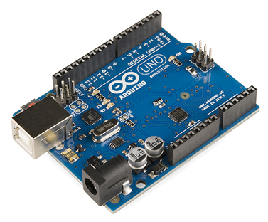
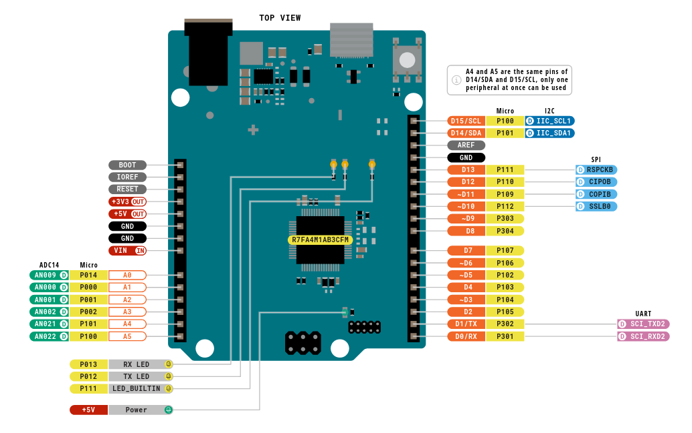

# Meet the Microcontroller
Now you will be programming the circuit in either Arduino IDE or the PlatformIO extension in VS Code. 

When you open a blank sketch/file in Arduino IDE you will see the following skeleton: 
```
void setup() {
  // put your setup code here, to run once:

}

void loop() {
  // put your main code here, to run repeatedly:

}
```
In PlatformIO you will see some additional sample code which you can delete and just remain with the same code skeleton as above with the exception to leave `#include <Arduino.h>` above `void setup()`. 

## Arduino Uno Board 
The Arduino UNO is a microcontroller board based on the ATmega328P. It has 14 digital input/output pins and 6 analog inputs. It’s an easy-to-use system designed for hobbyists.



The following pinout map shows the available pins on your Arduino Uno microcontroller and what functions those pins can be used for. Each pin can have multiple uses:
- Digital I/O (Input/Output) allows the Arduino Uno to read and write to components (LEDs, buttons, etc.) via digital signals. Digital output pins can send signals, either HIGH (5V) or LOW (0V), to other components. Digital input pins can read the state of a digital signal, such as whether a button is pressed or not. In this activity you’ll use a digital output to turn an LED on and off, and a digital input to detect whether a button is pressed.
- Analog inputs read continuous voltage from sensors or potentiometers.
- Communication protocols allow the Arduino Uno to communicate with peripheries via I2C, SPI and UART. 
Below is the pinout map for the Arduino Uno board you’re using in this activity. You will likely need to refer to this figure throughout the activity. The digital I/O pins are labeled D0 – D15, and the analog inputs are labeled A0 – A5. There are also pins that are dedicated to the communication protocols labeled I2C, SPI and UART.



## Connection to Activity 1 and 2
This activity is the final piece to connect the previous ones as it implements the software aspects of the Input, Microcontroller, and Output. 
- Input: push button
- Microcontroller: Arduino program
- Output: LED and Serial Monitor messages 

## Objective 
Create a program that starts a countdown when a push button is pressed. During the countdown, messages will be displayed in the Serial Monitor, and the LED will indicate when the countdown is complete. This will mimic a real world application of a timer. 
Within the `loop()` function try to implement each of these features:
- Read the button state
- Detect when button is pressed 
- Display timer countdown in the Serial Monitor
- Display timer start and completion messages in the Serial Monitor
- Turn on LED once countdown finishes

You should end up with similar output: 
```
Countdown started!
5
4
3
2
1
0
Countdown finished!
```

## Useful Code Syntax and Functions
- Single line comments: `// comment`.
- Multi-line comments: `/* ... */`.
- Every line of code must end with a semicolon `;`.
- Group blocks of code inside curly brackets `{}`.
- Use `const int` for fixed pin numbers and standard types like `int`, `float`, `bool`, and `unsigned long` for changing values.
- To set the pin as an input or output call `pinMode(pin, INPUT)` or `pinMode(pin, OUTPUT)`.
- Use `digitalWrite(pin, HIGH)` or `digitalWrite(pin, LOW)` to send voltage (eg. HIGH turns an LED on and LOW turns an LED off).
- Use `digitalRead(pin)` to check the pin state.
- Use `delay(ms)` to pause the program for a set amount of milliseconds (eg. `delay(1000)` pauses the program for one second).
- Use `Serial.begin(9600)` in `setup()` to start communication with your computer. The common baud rate for Arduino projects is 9600 but, the common baud rate for ESP32 projects is 115200. The baud rate specified in the code and the baud rate selected in the Serial Monitor must match for data to be displayed correctly.
-  To display information use `Serial.print()` and `Serial.println()` (`Serial.println()` prints the next displayed information on a new line).
-  `void` is a type of function (used for `setup()` and `loop()`) where no value is returned when the function terminates
-  A if-else statement is incredibly useful when coding and allows you to have code that executes when the conditions are met. Syntax:
    ```
    if (statement) { // example statement if(buttonState == HIGH)
      // do this
      // example: digitalWrite(ledPin, HIGH);
    } else {
      // do this instead
      // example: digitalWrite(ledPin, LOW);
    }
    ```
- A for loop is used to run the same block of code repeatedly by using a counter or stepping through a list/range of values. Syntax:
  ```
  for (initialization; condition; update) { // example: for(int i = 0; i < 5; i++)
    // code
    // example: Serial.println(i)
    // the example prints 0 1 2 3 4 with each number on a new
    // line and then exits since i would be incremented to 5
    // which does not meet i < 5 condition
  }
  ```

## Serial Monitor 
The Serial Monitor is an incredibly useful tool which can be used for debugging, testing concepts, or to communicate with the microcontroller. It displays and sends data over a serial connection (usually USB) between a computer and microcontroller. It uses `Serial.print()` and `Serial.println()` to display information to monitor and `Serial.begin(9600)` uses to match the baud rate settings. To set the baud rate in Arduino IDE Serial Monitor you can select the matching baud rate from the baud rate dropdown which is located at the top right of the Serial Monitor panel. To set the baud rate in PlatformIO, open the `platformio.ini` which is in the root of the project folder and add this line with the correct baud rate: `monitor_speed = 9600`. 

You can open the Serial Monitor in Arduino IDE by by clicking the magnifying glass icon in the top-right corner, going to Tools > Serial Monitor, or pressing Ctrl + Shift + M (Cmd + Shift + M on Mac). To open it in PlatformIO you can click the plug icon on the PlatformIO status bar at the bottom of VS Code.

## Variable Definitions 
Variable definitions sit above `setup()` as they declare pins that are used and other variables that will be used.

The pins that are used for this circuit are 2 and 3. You would declare them as the following: 
```
// Definitions
const int buttonPin = 3;
const int ledPin = 2;
const int TIMER = 5; // timer amount in seconds - can be changed 
```
## Setup
The setup function `setup()` runs once every time the code is uploaded to the microcontroller and sets pin modes, starts communication, initializes hardware, and sets initial values. 

You can paste the following setup that will be used for this program: 
```
// Setup
Serial.begin(9600); // starts communication with computer and IDE Serial Monitor 
pinMode(buttonPin, INPUT); // sets button pin as an input
pinMode(ledPin, OUTPUT); // sets led pin as an output
```

## Loop 
The loop function `loop()` runs the code inside continuously and repeats. 

Here is a skeleton code to help you execute the objectives listed above - complete the TODO comments: 
```
// Loop
  int buttonState = digitalRead(buttonPin);
  if (buttonState == HIGH) {
    // TODO: starting message
    for (int i = TIMER; i >= 0; i--) {
      // TODO: print the remaining time
      // TODO: delay before printing next second 
    }
    // TODO: turn the LED on
    // TODO: display ending message 
  }
```

## Extension Challenges
Here are some extra challenges you can add onto the activity to improve the basic timer: 
- Have a second button press turn off the LED and the next turn on the countdown and so on
- Have the LED flash during the timer and flashes more frequently as time ticks down
- Your idea!

<div align="center">
  <a href="Activity-2-Breadboarding Basics.md">⬅ Previous</a> | 
  <a href="Activity-3-Meet the Microcontroller.md">⬆ Top</a> |
  <a href="README.md">Back to beginning ➡</a>
</div>
